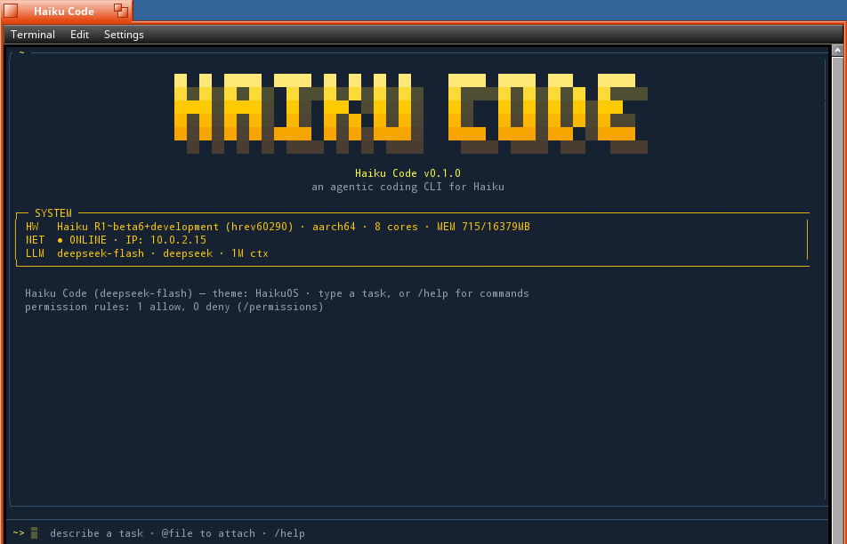

# Haiku Code

A full-screen **agentic coding CLI** for [Haiku](https://www.haiku-os.org/),
the BeOS-inspired open-source OS. It runs in Haiku's Terminal, talks to any
OpenAI-compatible chat API (default: DeepSeek) plus Anthropic's Messages API
and OpenAI's Responses API natively, and drives a Codex / Claude-Code-style
tool loop inside a [ratatui](https://ratatui.rs) terminal UI.

Haiku Code is a port of [picoder](https://github.com/bluevisor/picoder), the
coding agent built for the Raspberry Pi Zero W. It is one ~5 MB native Haiku
binary (`haikucode`), packaged as an `.hpkg` with a Deskbar entry.



## What's different on Haiku

- **Knows it's on Haiku.** The agent is told the OS release (read from
  `uname`, e.g. `Haiku R1~beta6+development (hrev60290)`) and Haiku's ground
  rules: no `sudo` or `which`, no `/proc`, `/boot/system` is read-only
  packagefs, software comes from `pkgman`, settings live in `~/config/settings`,
  files carry BFS attributes, and `open` / `hey` drive GUI apps.
- **Haiku paths.** User state lives in `~/config/settings/haikucode/`
  (`B_USER_SETTINGS_DIRECTORY`), not `~/.config`.
- **Live system panel.** The launch banner reads RAM from the kernel
  (`get_system_info`) instead of `/proc/meminfo`.
- **Terminal-safe rendering.** The logo is drawn as colored cells rather than
  block glyphs, which Haiku Terminal's fallback font draws wider than a cell.
- **Input that keeps working.** Keyboard input uses crossterm's plain `poll(2)`
  source on Haiku (its default mio source stops delivering keys after the
  first batch there), and the TUI exits when its terminal goes away, since
  Haiku sends no `SIGHUP` on hangup.
- **Sign-in in the right browser.** OAuth logins open with Haiku's `open`.
- **Deskbar launcher.** *Applications → Haiku Code* opens it in its own
  Terminal window.

## Features

- **Agentic tool loop** — `bash` (with timeout, or detached `background` jobs +
  `bash_output` / `bash_kill`), `read_file` / `write_file` / `edit_file` /
  `list_files`, `multi_edit` (a batch of edits across files in one approval),
  `grep` (regex), `glob`, `web_fetch`, `web_search`, `todo` (a visible plan),
  `ask_user`, `view_image`, and `remember` / `recall` memory. A `max_tool_calls`
  budget (default `0` = auto, 500; editable in `/config`) caps the model
  round-trips in a single turn. Read-only calls the model sends together
  (`read_file`, `list_files`, `grep`, `glob`, `web_fetch`, `web_search`,
  `recall`) run in parallel; everything else runs one at a time, in order.
- **Git auto-checkpoint** — every successful edit is committed to the
  working-directory repo (`auto_commit`, on by default), so each change is
  restorable; recent git history is fed into context as a clue. Set
  `"auto_bump_version": true` (config or `.haikucode/settings.json`) to also bump
  the `[package]` patch version in `Cargo.toml` with each checkpoint.
- **Crash-safe state** — `config.json` and session transcripts are written
  atomically (temp file → fsync → rename), so a power loss or VM crash
  leaves the old or new file intact, never a truncated one.
- **Forgiving edits** — `read_file` numbers lines `cat -n` style (number, tab,
  text) so the number can't be mistaken for indentation. When `edit_file`'s
  `old_text` doesn't match exactly, it is matched line by line ignoring each
  line's surrounding whitespace (then all of it, for a dropped space) and any
  pasted line numbers, and the new text is re-indented to the file's own
  indentation. A miss returns the closest real lines so the model can copy
  them. `multi_edit` takes a top-level `path` for single-file batches, and a
  malformed edit fails the batch with its number instead of being skipped.
- **Symlink-safe file tools** — `read_file` / `list_files` / `write_file` /
  `edit_file` all refuse symlinked paths, and paths are lexically normalized so
  the path you approve is the path that's used.
- **Sub-agents** — the `task` tool delegates a self-contained job to a fresh
  agent with its own context and the same tools; only its report comes back.
- **MCP** — servers from `mcp_servers` in `config.json` and from a project
  `.mcp.json` (Claude Code's format), over stdio or Streamable HTTP (with OAuth
  sign-in: `/mcp login <server>`). Tools show up as `mcp__<server>__<tool>`,
  resources through `list_mcp_resources` / `read_mcp_resource`, and prompts as
  `/mcp__<server>__<prompt>` commands. A project's servers only start once you
  `/mcp approve` them. `/mcp` shows each server's state, transport and auth.
- **Images** — `@image.png` attaches as a base64 data URI and `view_image`
  loads one from disk, sent as OpenAI multimodal content parts.
- **Streaming TUI** — a Claude-style composer with a reverse-block cursor,
  live token streaming, and colored unified diffs previewed before every
  write/edit.
- **Context compaction** — `/compact [focus]` summarizes older turns to free
  the window (the optional focus tells the summary what to preserve); triggers
  automatically at 80% full, including mid-turn during long tool loops. The
  window comes from `context_window`, else the provider's `/models`, else a
  built-in table (128k for unknown models).
- **Queued input** — keep typing while the agent works; Enter queues messages
  that send as turns finish.
- **One-shot `--output`** — `haikucode "task" -o out.md` writes the final reply to
  disk after the run.
- **Permission modes** (`Shift+Tab` / `Ctrl+P` to cycle) — *ask* / *YOLO*
  (approve everything; `/yolo` toggles it) / *plan* (read-only).
- **Remembered settings** — the permission mode, reasoning effort (`/effort`)
  and the brief/full thinking view (`Ctrl+T`) are saved to `config.json` when
  you change them, so the next session starts the same way.
- **Permission rules** — Claude-Code-style `allow` / `deny` patterns
  (`bash(cargo test:*)`, `edit_file(src/**)`, `mcp__fs__*`) in `config.json` or
  the project's `.haikucode/settings.json`. Deny rules hold even in YOLO mode;
  pressing **P** at an approval prompt saves a "don't ask again" rule for that
  command prefix or directory. `/permissions` lists, adds, and removes them.
- **OS sandbox for shell commands** — off by default. `"sandbox": "workspace"`
  lets `bash`, background jobs and `!cmd` write only under the working
  directory, its repo root, the temp dirs, haikucode's config dir and any
  `"sandbox_allow_write"` paths; `"readonly"` allows temp dirs only;
  `"sandbox_network": false` also blocks network access. Reads are never
  restricted. macOS uses `sandbox-exec`, Linux uses Landlock (network blocking
  needs kernel 6.7+; a kernel without Landlock runs commands unsandboxed and
  says so once). A blocked command comes back with a note naming the sandbox,
  so the model asks instead of working around it. A repo's `.haikucode/` settings
  can tighten the sandbox but never loosen it, and only your own config.json
  can add writable paths.
- **Search that respects .gitignore** — inside a git repo, `grep` and `glob`
  search git's own file list (tracked plus untracked-but-not-ignored), and
  `list_files` leaves out ignored entries, naming them in a footer.
- **Web search backends** — keyless DuckDuckGo by default; a bot-check page is
  reported as such instead of returning nothing. Set `"web_search_url"` to a
  SearXNG instance (with its JSON format enabled), or export `BRAVE_API_KEY` /
  `TAVILY_API_KEY`. `"web_search": "searxng" | "brave" | "tavily" | "duckduckgo"`
  pins one; `"web_search_key"` stands in for the env key.
- **Hooks** — `PreToolUse` / `PostToolUse` / `UserPromptSubmit` / `Stop` /
  `SessionStart` shell hooks (same JSON shape as Claude Code's) receive the
  event on stdin; exit `2` blocks the action and feeds stderr back to the model.
- **Custom slash commands** — drop a Markdown prompt in
  `.haikucode/commands/<name>.md` (or a `.haikucode/skills/<name>/SKILL.md`, or the
  same under `~/config/settings/haikucode/`) and `/name args` runs it with `$ARGUMENTS`
  substituted. `.claude/commands/*.md` is read too.
- **Skills the model uses itself** — any `<name>/SKILL.md` in `.haikucode/skills`,
  `.claude/skills` or `.agents/skills` (working directory up to the repo root)
  or `~/config/settings/haikucode/skills` is listed to the model by name and description
  only; when a task matches, it calls the `skill` tool to load the full
  instructions and the paths of the skill's other files. Other agents'
  user-wide folders (`~/.agents/skills`, `~/.claude/skills`) join the list only
  with `"shared_skills": true`, since their names and descriptions would go out
  with every request. Project skills win over user ones; `/name` still runs a
  skill by hand.
- **`!cmd`** — run a shell command straight from the composer; the output shows
  in the transcript and is added to the model's context.
- **`/diff`, `/undo`, `/review`** — see everything changed since the session
  started, revert the last haikucode checkpoint commit, or ask for a code review
  of the working tree / branch. `/status` and `/cost` report where you stand.
- **`/rewind`** — pick any earlier prompt from this run: haikucode's checkpoint
  commits since then are reverted (as one new commit; your own commits and
  unstaged work are left alone), the conversation is cut back to before that
  prompt, and the prompt returns to the composer to edit and resend. Edits made
  through `bash` aren't checkpointed, so they aren't undone.
- **Loop breaker** — a response that turns into one block of text repeated
  back to back (a sampling loop, common with local reasoning models) is cut
  off with an error instead of streaming forever.
- **Sampling** — haikucode sends no `temperature` unless you set one in
  `config.json` (`"temperature": 0.7`), so each model's recommended sampling
  applies; the DeepSeek preset keeps `0.2`.
- **Reasoning effort** — `/effort auto|off|low|medium|high|xhigh|max` (or the `/config`
  row) is translated per provider: DeepSeek/GLM `thinking`, OpenAI/Gemini/Groq
  `reasoning_effort`, OpenRouter `reasoning`, Anthropic adaptive thinking +
  `output_config.effort`, Responses `reasoning.effort`, and for self-hosted
  servers (Splash, vLLM, SGLang, llama.cpp) the chat template's
  `enable_thinking` — so `off` really stops a local Qwen from thinking. `auto`
  sends nothing. `xhigh` and `max` go out as-is to current Claude models
  (Opus 4.6/Sonnet 4.6 get `high` for `xhigh`), as `xhigh` to OpenAI GPT-5.2+
  and OpenRouter, and as `high` everywhere else.
- **Native APIs** — `"api": "chat" | "messages" | "responses"` picks the wire
  protocol; the anthropic preset defaults to Messages and the openai preset to
  Responses. Within a run, Anthropic's signed thinking and Responses' encrypted
  reasoning (stateless, `store: false`) are replayed across tool turns.
- **Prompt caching & cost** — Anthropic cache breakpoints on the system prompt
  and the latest turn, an OpenAI `prompt_cache_key`, and cache hits read from
  every protocol's usage. Cached input is priced at `price_cached_in` (default:
  DeepSeek's cache-hit price with the DeepSeek list, else a tenth of
  `price_in`); `/cost` and the one-shot JSON usage show cached tokens.
- **Thrashing guard** — the same tool call with identical arguments three times
  in a row is short-circuited with a nudge to change approach.
- **Scripting** — `git diff | haikucode "review this"` attaches stdin as context
  (or uses it as the task), and `--json` / `--stream-json` print a result
  object or JSON-lines events for CI and automation. One-shot runs use your
  `permission` setting (`--auto` forces YOLO); with no one to ask, approval
  prompts are declined, never silently approved. Exit status: `0` ok, `1` the
  run reported an error, `2` bad usage.
- **Context files** — in `~/config/settings/haikucode/` and in every directory from the
  repo root down to the working directory (just the working directory outside
  a repo), loads the first of `HAIKUCODE.md` / `AGENTS.md` / `CLAUDE.md` /
  `GEMINI.md`. They stack general to specific, so the nearest file wins on
  conflicts; 12k chars per file, 32k in all, spent nearest-first.
- **Sessions** — every TUI run is a saved session, many per working directory,
  titled by its first prompt. `haikucode -c` resumes the latest, `haikucode -r
  <id|name>` (or `/resume`, a picker) any of them; `/rename` names one, `/fork`
  (or `--fork-session` at launch) carries on in a copy, `/export [--all] [file]`
  writes a Markdown transcript, and `/new` starts another without deleting the
  last. `haikucode sessions [--json]` lists them for scripts; `/sessions delete`
  or `haikucode sessions delete <id>` removes one. The least recently used go
  past 50 per directory or 400 overall. One-shot runs are saved only with
  `-c` / `-r`.
- **Composer niceties** — a `/` command palette (suggestions ranked by your
  usage; ↑/↓ select, Tab fills, Enter runs), `@file` attach, Tab autocomplete
  (commands + paths), history, word-skip and word-delete, code-block
  highlighting.
- **Multi-line prompts** — pasted text keeps its newlines and tabs;
  Shift+Enter, Alt+Enter, Ctrl+J or a trailing `\` + Enter start a new line;
  the composer grows to a third of the screen, then scrolls. Multi-line
  entries survive in history, and `/rewind` hands back the prompt exactly as
  typed.
- **Status bar** — model · session tokens + cost · context-window bar ·
  account balance. Both money figures carry their own currency, and the ISO
  code is added when they differ (DeepSeek bills China-region accounts in CNY
  while its published price lists are USD), with a one-time hint on how to
  align them.
- **Settings panel** (`/config`) — provider preset, base URL, model, API key,
  auth mode, reasoning effort, default permission mode, auto-commit, theme, context
  window, max tool calls, and price currency, edited in-TUI; changes apply live
  and persist to `config.json`.
- **Themes** (`/theme`) — `HaikuOS` (the default: Haiku's yellow window tab
  and blue desktop), `Rainbow` (picoder's original Apple-rainbow look),
  `Apple ][` (green phosphor), `MSDOS`, `macOS`, `SUN`, `NeXT`, and `SGI`.
- **Launch banner** — a live SYSTEM panel with the Haiku release, cores,
  memory and IP; ASCII fallback under `TERM=linux` or `HAIKUCODE_ASCII=1`.

## Install / build

The quickest way on Haiku arm64: download the `.hpkg` from the
[latest release](https://github.com/bluevisor/haikucode/releases/latest) and
copy it into `~/config/packages` (it activates at once, no reboot).

### Updates

Haiku Code checks GitHub for a newer release when it starts (at most once a
day) and says so in the transcript. `/update` (or `haikucode update` in a
shell) downloads the new package, checks its SHA-256 against the release, and
swaps it into `~/config/packages`; the next launch runs the new version.
`haikucode update --force` reinstalls the current release. Turn the launch
check off with `"update_check": false` in `config.json`. Only the
`~/config/packages` install updates itself; a system-wide (`pkgman`) install
is left to `pkgman`.

Publishing a release (maintainers, from the Mac): bump `version` in
`Cargo.toml`, commit and push `main`, then `haiku/release.sh` builds the
package on the Haiku guest and creates the `v<version>` release with it.

### Building from source

Rust can't cross-compile to Haiku from macOS here, so Haiku Code builds
natively on Haiku. You need `rustc`/`cargo` for your Haiku architecture (the
arm64 VM uses a self-built `aarch64-unknown-haiku` nightly in
`/boot/system/non-packaged`; on x86_64, `pkgman install rust_bin` works).

On Haiku:

```sh
cargo build --release            # target/release/haikucode
haiku/package.sh                 # build + wrap in dist/haikucode-<ver>-1-<arch>.hpkg
cp dist/haikucode-*.hpkg ~/config/packages/   # activates at once, no reboot
# or: pkgman install dist/haikucode-*.hpkg    (system-wide)
```

From a Mac, with the Haiku box reachable over ssh:

```sh
haiku/deploy.sh                  # sync source, build + package on Haiku, activate it
haiku/deploy.sh fetch            # ...and copy the .hpkg back into ./dist
HAIKU_HOST=haiku haiku/deploy.sh # another ssh destination (default: haiku-dbg)
```

The package installs `bin/haikucode` (plus `hc`, a short alias), the
`apps/Haiku Code` launcher and its Deskbar entry. Run `haikucode` or `hc` from
any Terminal, or pick *Haiku Code* from the Deskbar's Applications menu.

## Testing / CI

```sh
cargo test --bins         # unit tests (run on Haiku and on the Mac)
cargo test -- --ignored   # also runs the live MCP / web tests
```

GitHub Actions (`.github/workflows/ci.yml`) runs the host test suite on Linux;
Haiku itself is covered by running the suite on the VM.

## Configuration

On first run, Haiku Code walks you through provider, model, and API key. State lives
in `~/config/settings/haikucode/`:

```
config.json   provider / model / key (0600), max_tool_calls, prices
              (+ optional mcp_servers, permissions, hooks, auto_bump_version)
commands/     user-wide custom slash commands (*.md)
skills/       user-wide skills (<name>/SKILL.md)
memory.md     remember/recall store; a note belongs to the directory it was
              made in (`- [/dir] note`) unless saved as global
history       composer history
sessions/     saved sessions: one folder per working directory, each
              session a <id>.json conversation + <id>.meta.json
```

Per-project settings live in `.haikucode/` inside the working directory:

```
.haikucode/settings.json        permissions, hooks, auto_bump_version (shared)
.haikucode/settings.local.json  your own rules (P at an approval prompt writes
                              here) — add it to .gitignore
.haikucode/commands/*.md        project slash commands
.haikucode/skills/<name>/SKILL.md
```

### Permissions and hooks

```json
{
  "permissions": {
    "allow": ["bash(cargo test:*)", "bash(git status:*)", "edit_file(src/**)", "read_file"],
    "deny":  ["bash(rm -rf *)", "bash(git push:*)", "edit_file(.env*)"]
  },
  "hooks": {
    "PreToolUse":  [{ "matcher": "bash", "hooks": [{ "type": "command", "command": "./scripts/guard.sh" }] }],
    "PostToolUse": [{ "matcher": "edit_file|write_file|multi_edit", "hooks": [{ "type": "command", "command": "cargo fmt" }] }],
    "Stop":        [{ "hooks": [{ "type": "command", "command": "cargo test -q 2>&1 | tail -3" }] }]
  }
}
```

A rule is `tool` or `tool(pattern)`. For `bash`, `prefix:*` matches the prefix
alone or followed by more words, a plain pattern is a prefix, and `*` is a
wildcard; compound commands (`a && b`, `a; b`, `a | b`, `a & b`) are allowed
only if every segment is and denied if any is, and a command that hides
another command (`$(…)`, backticks, `<(…)`, `sh -c`, `sudo`, `xargs`, `eval`)
is never auto-allowed. File tools take globs on the normalized path, so
`src/../src/x` and `./src/x` are the same file to a rule. Claude Code's `Bash(...)`,
`Edit(...)`, `Read(...)`, `Write(...)` spellings are accepted. Hooks get a JSON
payload (`hook_event_name`, `tool_name`, `tool_input`, `tool_response`, `cwd`)
on stdin; exit `0` continues (stdout becomes extra context), exit `2` blocks
and feeds stderr to the model, anything else is a non-blocking warning.

### Currency

The status line shows the session cost and the account balance. The cost comes
from `price_in` / `price_out` (per 1M tokens) and is quoted in
`price_currency`, which defaults to `USD` — the unit of the built-in prices.
The balance comes from the provider and carries whatever currency the account
is billed in: DeepSeek answers `CNY` for China-region accounts and `USD`
elsewhere.

When the two differ, both figures are tagged with their ISO code rather than
printed as bare symbols, so `$0.03 USD` can't be read as ¥0.03 next to a
`bal ¥135.70 CNY`. To make them line up, set both sides to the account's
currency — the `price currency` row in `/config`, plus that currency's price
list:

```json
{
  "price_currency": "CNY",
  "price_in": 1.0,
  "price_out": 2.0
}
```

Prices are never converted between currencies (that would need an exchange
rate), so put the numbers in the account's currency yourself — DeepSeek
publishes a CNY price list alongside its USD one. An unrecognized code prints as
a `CODE 12.34` prefix rather than guessing a symbol.

To expose [MCP](https://modelcontextprotocol.io) servers, add an `mcp_servers`
block to `config.json`. A `command` is launched over stdio; a `url` is spoken
to over Streamable HTTP, with optional static `headers`. `${VAR}` and
`${VAR:-default}` are expanded from the environment in every field:

```json
"mcp_servers": {
  "filesystem": {
    "command": "npx",
    "args": ["-y", "@modelcontextprotocol/server-filesystem", "/home/pi"]
  },
  "tracker": {
    "url": "https://mcp.example.com/mcp",
    "headers": {"X-Team": "${TEAM_ID}"}
  }
}
```

An HTTP server that answers 401 waits for `/mcp login <server>`: haikucode finds
its authorization server (protected-resource and authorization-server
metadata), registers itself as a client when the server allows dynamic
registration, and signs you in through the browser with PKCE. The token is kept
in `~/config/settings/haikucode/mcp-oauth.json` (mode `0600`) and refreshed when it
expires; `/mcp logout <server>` forgets it. For a server without dynamic
registration, give its client id: `"oauth": {"client_id": "…", "callback_port": 8976}`.
Set `HAIKUCODE_BROWSER` to the command that opens the sign-in URL on a headless
box.

A project can also ship its servers in `.mcp.json` (`{"mcpServers": {…}}`, the
working directory or the repo root). Those can run any command, so each one
waits for `/mcp approve <name>` (or `/mcp deny <name>`); the decision is
remembered for that exact entry, so a changed entry asks again.

## Commands

Type `/` in the composer for the ranked palette, or `/help` for the full list.

| Command | Action |
| --- | --- |
| `/model [id\|n]` | open the model picker, or set directly by id/number |
| `/config` | settings panel (provider, model, key, reasoning, …) |
| `/effort [level]` | reasoning effort: auto, off, low, medium, high, xhigh, max |
| `/compact [focus]` | summarize older turns to free context (auto at 80%) |
| `/diff` | show everything changed since the session started |
| `/undo` | revert the last haikucode checkpoint commit |
| `/rewind` | pick an earlier prompt: undo haikucode's edits since then and resume from there |
| `/review [base]` | review uncommitted + branch changes vs `base` |
| `/status` · `/cost` | model, cwd, git, rules, context · token usage and cost |
| `/permissions [allow\|deny\|remove <rule>]` | list or edit permission rules |
| `/hooks` · `/commands` | list hooks · reload and list custom commands |
| `!cmd` | run a shell command; output goes to the transcript and the model |
| `/reset` | clear conversation context |
| `/new` | start a new session (the current one stays saved) |
| `/resume [id\|name]` | switch to another saved session here (a picker without an argument) |
| `/rename <name>` | name this session |
| `/fork` | carry on in a copy of this conversation; the original stays as it was |
| `/export [--all] [file]` | save the conversation as Markdown (`--all` keeps system/context messages) |
| `/sessions [delete <id\|name>]` | list or delete this directory's saved sessions |
| `/yolo` (or `/auto`) | toggle YOLO mode (approve everything) |
| `/mcp` | list MCP servers: state, transport, auth, tools and prompts |
| `/mcp approve\|deny\|login\|logout <server>` | allow a project server, sign in to an HTTP one, … |
| `/memory` | show the persistent memory this directory sees |
| `/theme [n]` | open the theme picker, or switch directly |
| `/init` | summarize this project into `HAIKUCODE.md` |
| `/clear` | clear the screen transcript |
| `/update [--force]` | install the latest release from GitHub |
| `/help` · `/exit` | show help · quit |

## Keyboard

| Key | Action |
| --- | --- |
| `Enter` | send |
| `Shift+Enter` / `Alt+Enter` / `Ctrl+J` / `\` then `Enter` | new line in the composer (the last two work on any terminal) |
| `Shift+Tab` / `Ctrl+P` | cycle permission mode |
| `↑` / `↓` | move between the composer's lines; on its first/last line, previous / next prompt |
| `Home` / `End` | start / end of the composer line |
| `PgUp` / `PgDn` | scroll the output a page |
| mouse wheel | scroll the output (when mouse capture is on) |
| `Ctrl` / `Alt + ↑` / `↓` | scroll the output (3 lines) |
| `Alt`/`Ctrl`/`Cmd + ←/→` | word / line motion |
| `Option`/`Alt + Backspace` | delete word backward |
| `Option`/`Alt + Delete` | delete word forward |
| `Tab` | autocomplete commands / paths |
| `Ctrl+L` | redraw screen |
| `Esc` | interrupt turn / clear line; on an approval prompt: deny and stop |
| `Y` / `N` / `P` / `A` | approval prompt: yes / no (model continues) / don't ask again for this pattern / YOLO (approve everything) |
| `Ctrl+C` | clear line, or quit (press twice) |

haikucode enables the [Kitty keyboard protocol](https://sw.kovidgoyal.net/kitty/keyboard-protocol/)
when the terminal supports it, so modified keys are reported unambiguously.
Without it, some terminals (e.g. Warp in full-screen mode) flatten
`Option+Backspace` to a plain Backspace.

Mouse capture is skipped on Warp (`TERM_PROGRAM=WarpTerminal`) because it grabs
click-drag text selection with no modifier to bypass it — Warp users scroll with
`Ctrl`+`↑`/`↓` and `PgUp`/`PgDn` instead. Set `HAIKUCODE_MOUSE=1` to force capture on
(wheel scrolling, at the cost of native selection), or `HAIKUCODE_MOUSE=0` to turn
it off everywhere.

## Architecture

A long-lived **worker thread** owns the message history and runs the blocking
HTTP + tool loop. The **UI thread** renders with ratatui and exchanges user
input / approvals over mpsc channels; the worker streams back tokens, tool
events, diffs, and approval requests. This keeps the UI responsive and lets
`Esc` interrupt a turn mid-flight.

The transcript render is cached: the static (already-printed) lines are wrapped
once and reused until their content or the terminal width changes, so streaming
a reply doesn't re-wrap the whole backlog every token — the difference is
visible on a slow VM.

See [`HAIKUCODE.md`](HAIKUCODE.md) for the per-file source map and deeper notes.

## License

MIT
